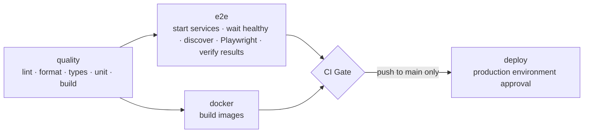

# TaskBoard

A full-stack task manager (React + Express + SQLite) with a Playwright end-to-end suite and a
GitHub Actions pipeline that blocks merges and deployments unless every check passes.

```text
.
├── backend/      Express 5 + TypeScript API, SQLite via node:sqlite, Vitest + Supertest
├── frontend/     React 19 + Vite SPA, Vitest + Testing Library
├── playwright/   End-to-end, API and regression suites (separate npm workspace)
├── scripts/      start/wait/stop services (used by CI), branch-protection setup
├── docs/         Contracts, API reference, CI/CD and branch-protection guides, sample report
├── .github/      CI workflow, CODEOWNERS, PR template
└── docker-compose.yml, backend/Dockerfile, frontend/Dockerfile
```

## Stack decisions

| Choice                            | Why                                                                                                            |
| --------------------------------- | -------------------------------------------------------------------------------------------------------------- |
| npm workspaces, one lockfile      | Frontend, backend and Playwright stay separate packages but install reproducibly with one `npm ci`.            |
| SQLite via built-in `node:sqlite` | Real persistence with no native build step or database server; works identically locally, in CI and in Docker. |
| Express 5 + zod                   | Async errors propagate automatically; one schema per endpoint gives consistent `400` responses.                |
| JWT (HS256) bearer tokens         | Stateless auth that is easy to drive from both the browser and API tests.                                      |
| Vite preview proxies `/api`       | The browser talks to a single origin, so no CORS setup is needed in dev, CI or Docker (nginx proxies there).   |

The interfaces between the parts are defined in [docs/CONTRACTS.md](docs/CONTRACTS.md).

## Prerequisites

- Node.js **22.13+** (CI uses 24, see `.nvmrc`). No database server is needed.
- Optional: Docker, to use `docker-compose.yml`.

## Run it locally

```bash
npm install
```

**Development** (auto-reload):

```bash
npm run dev
```

Open **http://localhost:5173**. The API runs on http://localhost:3001 (`/api/health`), and Vite proxies `/api` to it.
To run them separately: `npm run dev -w backend` and `npm run dev -w frontend`.

**Production build** (what CI tests against):

```bash
npm run build
npm start
```

Open **http://localhost:4173**.

**Docker** (not verified locally; built in CI by the `docker` job):

```bash
JWT_SECRET=$(openssl rand -hex 32) docker compose up --build
```

Open **http://localhost:8080**.

### Configuration

No configuration is needed for local development; defaults include a dev-only JWT secret. All variables are listed in
[.env.example](.env.example) and documented in [docs/API.md](docs/API.md). Export them in your shell (the backend does
not load `.env` files). `JWT_SECRET` (≥ 32 chars) is **required** when `NODE_ENV=production`.

Data is stored in `backend/data/taskboard.db` by default; delete it to reset. Migrations run automatically at startup.

## Tests and checks

| Command                                                              | What it runs                                                                    |
| -------------------------------------------------------------------- | ------------------------------------------------------------------------------- |
| `npm run lint`                                                       | ESLint across all workspaces (zero warnings allowed)                            |
| `npm run format:check`                                               | Prettier                                                                        |
| `npm run typecheck`                                                  | `tsc --noEmit` in every workspace                                               |
| `npm run test:unit`                                                  | Backend (Vitest + Supertest) and frontend (Vitest + Testing Library) unit tests |
| `npm run build`                                                      | Backend `tsc` build and frontend Vite build                                     |
| `npm run verify`                                                     | All of the above, in CI order                                                   |
| `npm run test:e2e`                                                   | Every Playwright test (run `npm run build` first)                               |
| `npm run test:smoke -w playwright` / `test:regression -w playwright` | Tagged subsets                                                                  |
| `npm run report -w playwright`                                       | Open the last HTML report                                                       |

First-time Playwright setup: `npx playwright install chromium`.

`npm run test:e2e` starts the API (with a throwaway database) and the web preview itself, or reuses them if they are
already running. Set `PW_SKIP_WEBSERVER=1` to require externally started services, as CI does.

### Test suites

| Suite                             | Project  | Covers                                                                                                                                                               |
| --------------------------------- | -------- | -------------------------------------------------------------------------------------------------------------------------------------------------------------------- |
| `tests/smoke/` `@smoke`           | chromium | App loads, health endpoint, login page, not-found route                                                                                                              |
| `tests/e2e/`                      | chromium | Register/login/logout, route guards, session restore, validation, task CRUD, filters, search, persistence, per-user isolation                                        |
| `tests/api/`                      | api      | Auth and task endpoints, status codes, error envelope, authorization (IDOR), malformed input                                                                         |
| `tests/regression/` `@regression` | chromium | `REG-xxx` guards. REG-001 to REG-006 guard well-known bug classes for this kind of app; REG-007 guards a real defect found in integration testing (mobile overflow). |

Every test creates its own user through the API, so tests are independent and safe to run in parallel.

## Adding a Playwright test

1. Create `playwright/tests/<any-folder>/<name>.spec.ts`. Files under `tests/api/` run in the `api` project (no
   browser); everything else runs in `chromium`.
2. Import `test`/`expect` from `playwright/fixtures` and use the `api`, `testUser` and `authenticatedPage` fixtures
   and the page objects in `playwright/pages/`.
3. Tag it if it belongs to a suite: `test('…', { tag: '@smoke' }, …)`.
4. Run `npm run verify:discovery -w playwright` and `npm run test:e2e`.

No workflow change is needed: CI runs every discovered spec. `verify:discovery` fails the build if a file in
`tests/` is not named `*.spec.ts` (Playwright would silently ignore it) or if a spec yields no tests. See
[playwright/README.md](playwright/README.md).

## How failures block a merge

The workflow ([.github/workflows/ci.yml](.github/workflows/ci.yml)) runs on every push, on pull requests and on
manual dispatch:



- Any failing step makes its job fail. There is no `continue-on-error` and no `|| true`.
- **CI Gate** always runs and passes only if every upstream job result is exactly `success`, so failed, skipped and
  cancelled jobs all block. It is the single required status check.
- If the services don't become healthy, `wait-for-services.sh` fails the job and prints the service logs.
  Playwright's global setup also refuses to run tests against an unhealthy app.
- `verify:results` fails if zero tests ran, if any test failed, if any test was skipped, or if no results file exists.
- Reports are always uploaded (`playwright-report`, `test-results` with traces, screenshots, videos and JUnit, plus
  `logs`), and a summary is written to the job page.

Three separate controls apply, and a green build grants none of the other two:

1. **CI success**: the `CI Gate` check.
2. **Merge approval**: branch protection on `main` requires `CI Gate`, an up-to-date branch, one approving review, and
   CODEOWNERS review for test configuration, CI files and scripts. Changes that exclude tests or weaken checks
   therefore need explicit review.
3. **Deployment**: the `deploy` job runs only for pushes to `main`, after the gate, in the `production` environment,
   which should require reviewer approval. The deploy steps are placeholders.

Branch protection and the `production` environment have to be configured on GitHub. See
[docs/BRANCH-PROTECTION.md](docs/BRANCH-PROTECTION.md) (`scripts/setup-branch-protection.sh OWNER REPO` does it via
`gh`). Replace the placeholder team in `.github/CODEOWNERS`. More detail: [docs/CI-CD.md](docs/CI-CD.md).

A sample of how results and failures are surfaced is in [docs/sample-report/](docs/sample-report/).

## Documentation

- [docs/CONTRACTS.md](docs/CONTRACTS.md): API, UI selector and Playwright↔CI contracts
- [docs/API.md](docs/API.md): endpoint reference and environment variables
- [docs/CI-CD.md](docs/CI-CD.md): pipeline stages, artifacts, reproducing CI locally
- [docs/BRANCH-PROTECTION.md](docs/BRANCH-PROTECTION.md): merge and deployment protection setup
- [docs/design/taskboard-design-system.html](docs/design/taskboard-design-system.html): the "Ledger" design system (tokens, components, screen mockups, handoff rules); implemented in `frontend/src/design/`
- [backend/README.md](backend/README.md), [frontend/README.md](frontend/README.md), [playwright/README.md](playwright/README.md)
