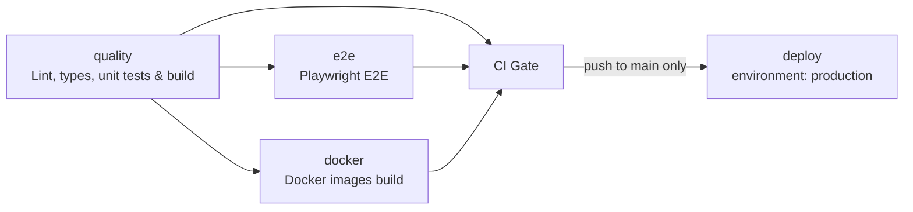

# CI/CD

Workflow: [`.github/workflows/ci.yml`](../.github/workflows/ci.yml). Runs on every push, on pull requests
(opened, synchronize, reopened, ready_for_review) and on manual dispatch. A newer run on the same ref cancels the
older one. Workflow permissions are `contents: read`.



## Jobs

| Job (display name)                        | Purpose                                                                                                                                                                                                                  |
| ----------------------------------------- | ------------------------------------------------------------------------------------------------------------------------------------------------------------------------------------------------------------------------ |
| `quality` Lint, types, unit tests & build | `npm ci`, `lint`, `format:check`, `typecheck`, `test:unit`, `build` - each a separate step so the failing stage is obvious.                                                                                              |
| `e2e` Playwright E2E                      | Builds, installs Chromium (cached by Playwright version), starts the API and the web preview with a throwaway `JWT_SECRET` and a fresh SQLite file, waits for health, runs `verify:discovery`, `test`, `verify:results`. |
| `docker` Docker images build              | Builds (does not push) both Dockerfiles so a broken image is caught on the PR. Included in the gate.                                                                                                                     |
| `ci-gate` CI Gate                         | Always runs; fails unless `quality`, `e2e` and `docker` are all `success`. Skipped, cancelled and failed all block.                                                                                                      |
| `deploy` Deploy to production             | Only on push to `main`, after the gate, in the `production` environment (manual approval). Steps are placeholders.                                                                                                       |

There is no `continue-on-error`, no `|| true` and no `--pass-with-no-tests` anywhere in the workflow.

## How failures block

- Branch protection requires exactly one status check: **CI Gate** (see [BRANCH-PROTECTION.md](BRANCH-PROTECTION.md)).
- Because `ci-gate` runs with `if: always()` and checks each upstream `result == 'success'`, a failed, cancelled or skipped
  upstream job turns the gate red. (A _skipped_ required check would otherwise be treated as passing.)
- Silent-pass protection in the E2E job: `verify:discovery` fails when a spec file is not discovered, a stray non-spec
  `.ts` sits in `tests/`, or zero tests are found; `verify:results` (runs even if tests failed) fails on zero executed
  tests, any failure, or any skipped test, and also if `results.json` is missing. ESLint makes `test.only`,
  `test.skip` and `waitForTimeout` errors in `playwright/tests/**`.

## Unhealthy services

`scripts/wait-for-services.sh` polls `http://localhost:3001/api/health` and `http://localhost:4173/` (timeout 120 s).
It exits non-zero immediately if a started process has died (pid files), or at the timeout if a URL is not 2xx,
printing the tail of `logs/backend.log` / `logs/frontend.log` in the job log. Tests never start against an unhealthy
stack. Services are stopped in an `if: always()` step (`scripts/stop-services.sh`).

## Artifacts and reports

Uploaded `if: always()` with 14-day retention (Actions run page, "Artifacts"):

| Artifact            | Contents                                                               |
| ------------------- | ---------------------------------------------------------------------- |
| `playwright-report` | HTML report. Download, unzip, then `npx playwright show-report <dir>`. |
| `test-results`      | traces, screenshots, videos, `results.json`, `junit.xml`, `summary.md` |
| `logs`              | `backend.log`, `frontend.log` from the services                        |

Open a trace with `npx playwright show-trace <path>/trace.zip` (or upload it to trace.playwright.dev). The pass/fail summary
is also written to the run's Job Summary by `verify:results`.

## CI success vs. merge approval vs. deployment

These are three separate controls:

1. **CI success** - the `CI Gate` check is green. Says the code is technically healthy.
2. **Merge approval** - branch protection on `main`: PR required, at least 1 approval, stale approvals dismissed on
   new commits, review from code owners (`.github/CODEOWNERS` - tests config, Playwright scripts, CI and lint config
   need QA-lead approval), conversations resolved, branch up to date, admins included, no force pushes or deletions.
   Green CI alone never merges anything.
3. **Deployment** - only after a push to `main` (i.e. a merged PR), and only when a reviewer of the GitHub Environment
   `production` approves the paused `deploy` job.

`.github/CODEOWNERS` uses the placeholder team `@your-org/qa-leads`; replace it before enabling "Require review from
Code Owners".

## New tests need no workflow changes

Playwright discovers every `playwright/tests/**/*.spec.ts` (and `verify:discovery` fails when one is missed). The workflow
runs `npm run test -w playwright`, so adding a spec file is enough. Do not add path filters or per-file steps.

## Reproduce CI locally

```bash
npm ci
npm run verify                                  # lint, format:check, typecheck, unit tests, build
npx playwright install chromium                 # once
export JWT_SECRET="$(openssl rand -hex 32)"
scripts/start-services.sh                       # API :3001, web :4173, logs in ./logs
scripts/wait-for-services.sh -p logs/backend.pid -p logs/frontend.pid \
  -l logs/backend.log -l logs/frontend.log http://localhost:3001/api/health http://localhost:4173/
export CI=true PW_SKIP_WEBSERVER=1
npm run verify:discovery -w playwright
npm run test -w playwright
npm run verify:results -w playwright
scripts/stop-services.sh
```

Use `API_PORT` / `WEB_PORT` / `LOG_DIR` to run on other ports. Docker stack: `JWT_SECRET=$(openssl rand -hex 32) docker compose up --build`
(UI on http://localhost:8080).
